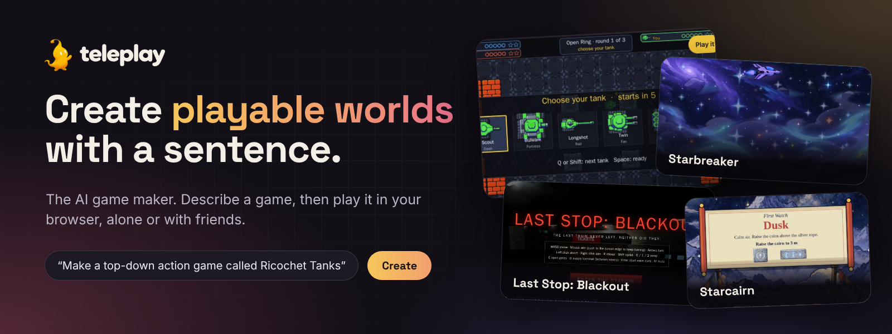
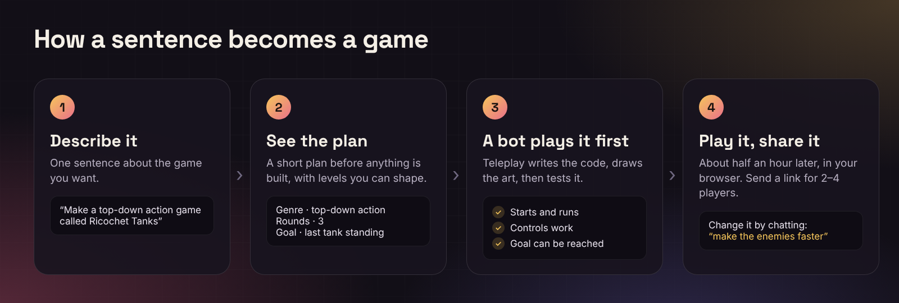
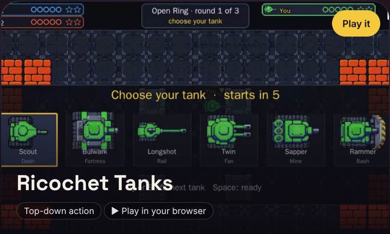
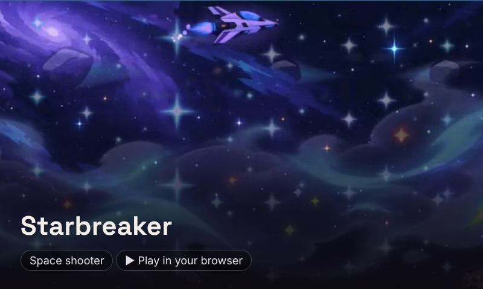
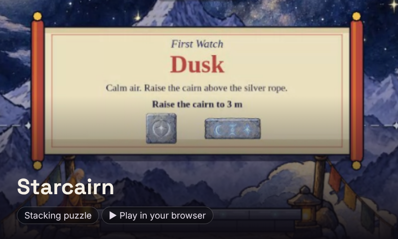
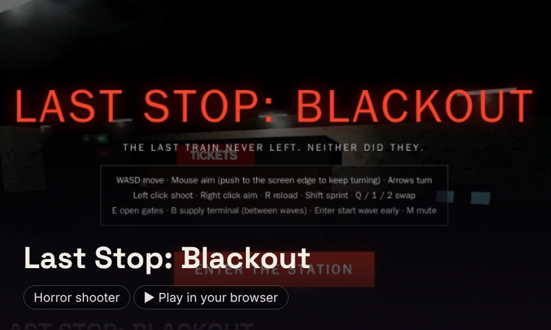
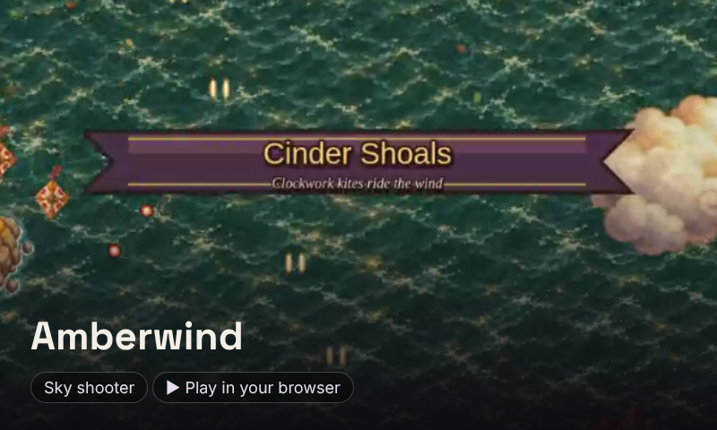
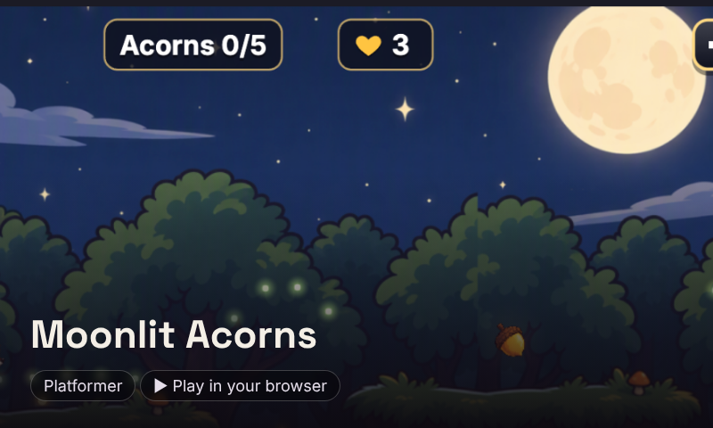

  

  
  
  
  

Everyone has a game in their head. Most people never get to play it.

**Teleplay is an AI game maker.** Type one sentence, and Teleplay plans the game, writes its code, draws its art and gives it its own music and sound. Before you ever see it, a bot plays it through. About half an hour later it has its own page: play it in your browser, or send the link and bring 2 to 4 friends into the same game.

  

## Made with Teleplay

Every one of these started as one sentence. Click one to play it; there's nothing to install.

<table>
  <tr>
    <td width="33%"></td>
    <td width="33%"></td>
    <td width="33%"></td>
  </tr>
  <tr>
    <td width="33%"></td>
    <td width="33%"></td>
    <td width="33%"></td>
  </tr>
</table>

<a href="https://www.teleplay.ai/discover"><b>See every game on Discover →</b></a>

## Change it by talking to it

*"make the enemies faster"* · *"add a boss to the last level"* · *"make it night"*

Tell the editor what should be different, and Teleplay rebuilds the game and tests it again. Undo takes a change back. Small things, like speed, jump height and health, are sliders you can drag while the game runs.

## On GitHub

| | |
|---|---|
| [**teleplay**](https://github.com/teleplayai/teleplay) | Report a bug or suggest an idea. |
| [**press-kit**](https://github.com/teleplayai/press-kit) | Logos, screenshots and copy, free to use when you write about Teleplay. |

## Good to know

- 2D games, and 3D in beta for testers. Multiplayer is in beta.
- Playing, remixing and saving games is free. Building your own is on the Pro and Extreme plans.
- English and Turkish. For ages 13 and up.
- Found a security problem? Please email info@teleplay.ai instead of opening an issue ([SECURITY](https://github.com/teleplayai/.github/blob/main/SECURITY.md)).

Teleplay (teleplay.ai) is an AI game maker by Electrica, Inc. It is not the TV-script, short-drama or streaming tool that shares the name.
